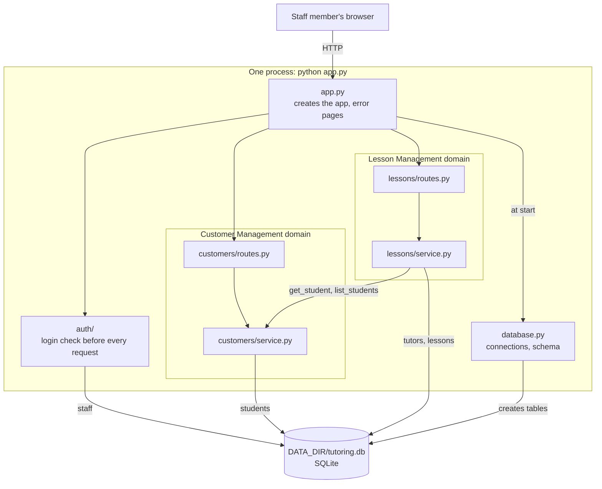
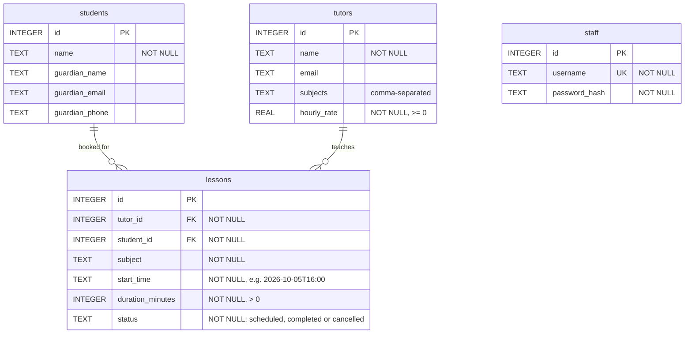

# Tutoring Company Manager 

A small application for an independent tutoring company. This system helps the company keep track of their customers,
the scheduled lessons, which tutor is teaching which lesson, and the state of the lessons (scheduled, cancelled, completed)
It is a single-process Flask application that stores all data in SQLite.

## What it does

- **Lessons:** schedule a lesson for a student with a tutor, mark it completed
  or cancelled, and filter the schedule by status or by tutor. The app refuses
  double bookings. A tutor or a student can never have two lessons at the same
  time. A tutor who lists subjects can only be booked for those subjects.
- **Students:** add, search, edit and delete students and their guardian's
  contact details. A student who still has lessons cannot be deleted.
- **Tutors:** add and edit tutors, their subjects and their hourly rate.
- **Staff login:** every page requires a staff login.

## Requirements

- Python 3.10 or newer
- pip

## Setup and run

```bash
git clone <your-repository-url>
cd <repository-folder>
python3 -m venv .venv
# macOS / Linux:  source .venv/bin/activate
# Windows:        .venv\Scripts\activate
pip install -r requirements.txt
python app.py
```

The app listens on port 8000. Check that it is running by opening
http://localhost:8000/health, which returns `{"status": "ok"}`.

The database file and its tables are created automatically when the app
starts. There is no separate setup or migration step.

## Logging in

Every page except `/health` requires a staff login. When the app starts and
no staff account exists yet, it creates one called `admin` with a random
password and prints that password once in the terminal:

```
Created staff account 'admin' with password: ...
```

To choose the password yourself, set `ADMIN_PASSWORD` when starting the app,
for example `ADMIN_PASSWORD=my-password python app.py`. If the account already
exists, this resets its password.

## Configuration

Everything is configured with environment variables. None of them are required.

| Variable         | Default                     | Purpose                                                   |
|------------------|-----------------------------|-----------------------------------------------------------|
| `PORT`           | `8000`                      | Port the server listens on                                |
| `DATA_DIR`       | `data/` next to `app.py`    | Folder that holds the SQLite file                         |
| `SECRET_KEY`     | random value on every start | Signs the login cookie; set a fixed value in production   |
| `ADMIN_USERNAME` | `admin`                     | Username of the staff account created at start            |
| `ADMIN_PASSWORD` | random, printed once        | Password of that account; setting it resets the password  |

The SQLite database is always stored at `$DATA_DIR/tutoring.db`.

Because `SECRET_KEY` is random by default, restarting the app logs everyone
out. Set a fixed `SECRET_KEY` to keep people logged in across restarts.

## Deployment contract

The app is built to be containerised later without changes:

- one process, started with `python app.py`
- listens on `0.0.0.0`, port taken from `PORT`
- all data in one SQLite file under `DATA_DIR`
- no interactive setup: tables and the admin account are created at start
- configured only through environment variables, no `.env` file needed
- `/health` answers without a login, for health checks

## Architecture



Each domain has two layers. `routes.py` handles HTTP: it reads the request,
gets a database connection from `database.py` (`get_db`), passes it to the
service and chooses the page to show. `service.py` holds the business rules
and the SQL, and takes that connection as its first argument, so it can be
tested without Flask.

The two domains meet in exactly one place: `lessons/service.py` gets student
details by calling `customers/service.py`, never by reading the `students`
table. If the domains become separate services later, that call becomes an
HTTP request and nothing else in Lesson Management changes (see ADR-2).

## Database schema



`students` belongs to Customer Management; `tutors` and `lessons` belong to
Lesson Management; `staff` belongs to the login module. `lessons.student_id`
is the only foreign key that crosses the line between the two domains
(see ADR-3). Because foreign keys are switched on, a student who still has
lessons cannot be deleted.

## Tests and coverage

Run the tests:

```bash
pytest
```

Run them with a coverage report:

```bash
pytest --cov=customers --cov=lessons --cov=auth --cov-report=term-missing
```

Coverage is measured on the business logic in each `service.py`.
The Flask routes only pass requests through to the services, so `.coveragerc`
leaves them out of the measurement (see ADR-4).

Latest result: 76 tests passed, 100% coverage of `customers/service.py`,
`lessons/service.py` and `auth/service.py`.

## Project structure

```
app.py               entry point. It creates the Flask app and starts the server
database.py          SQLite connection handling and schema
auth/                staff login (protects both domains)
customers/           Customer Management domain (students, guardians)
lessons/             Lesson Management domain (tutors, lessons, lesson status)
templates/, static/  HTML templates and CSS for the web pages
tests/               automated tests for the business logic
ADR.md               architecture decision records
AI_USAGE.md          log of AI assistance
```

## Decisions and AI use

- [ADR.md](ADR.md) records the five main design decisions and why they were made.
- [AI_USAGE.md](AI_USAGE.md) logs every meaningful use of AI in this project.